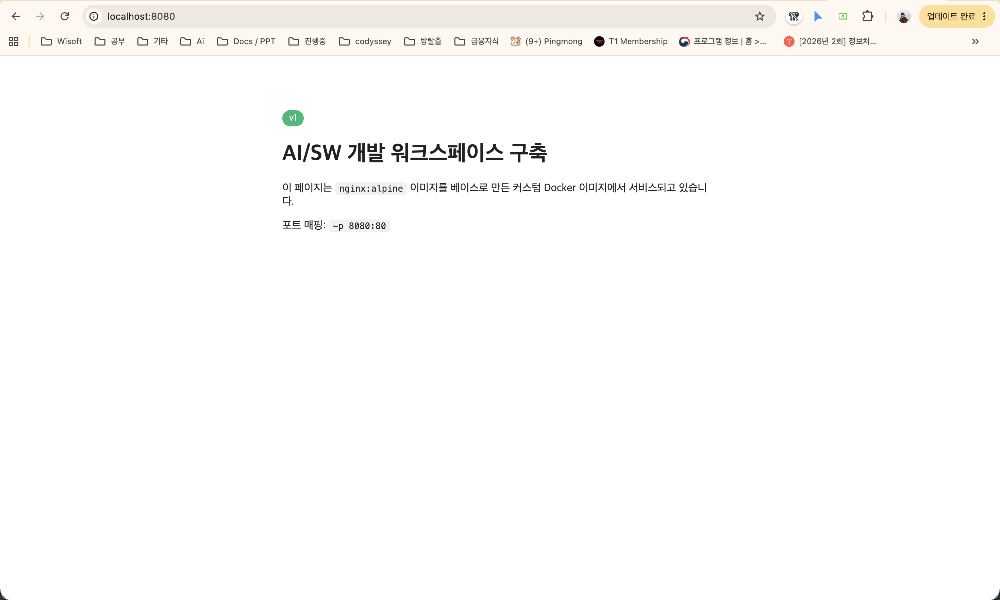
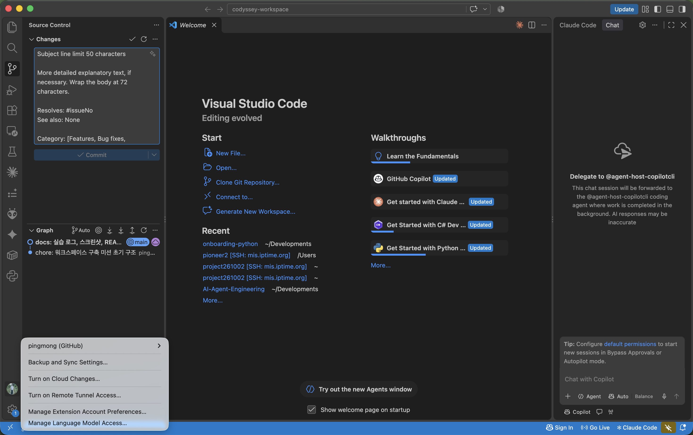

# 워크스페이스 구축 가이드 — 처음부터 끝까지

> 이 문서는 **"AI/SW 개발 워크스페이스 구축" 미션을 처음 하는 분**을 위한 설명서입니다.
> 각 단계마다 "왜 하는지 → 무엇을 치는지 → 무엇이 나오는지 → 그게 무슨 뜻인지" 순서로 적었어요.
> 명령은 전부 이 저장소의 `scripts/` 에 들어 있어서, 직접 치지 않고 `bash scripts/01-terminal.sh` 처럼 실행해도 됩니다.

---

## 목차

- [0. 시작하기 전에: 이 미션의 큰 그림](#0-시작하기-전에-이-미션의-큰-그림)
- [1. 터미널 — 폴더와 파일 다루기](#1-터미널--폴더와-파일-다루기)
- [2. 권한 — rwx와 755/644의 의미](#2-권한--rwx와-755644의-의미)
- [3. Docker 설치 확인](#3-docker-설치-확인)
- [4. 컨테이너 처음 띄워 보기](#4-컨테이너-처음-띄워-보기)
- [5. Docker 운영 명령 6개](#5-docker-운영-명령-6개)
- [6. 나만의 이미지 만들기 (Dockerfile)](#6-나만의-이미지-만들기-dockerfile)
- [7. 포트 매핑 — 브라우저에서 열기](#7-포트-매핑--브라우저에서-열기)
- [8. 바인드 마운트 vs 볼륨](#8-바인드-마운트-vs-볼륨)
- [9. Git · GitHub · VSCode](#9-git--github--vscode)
- [보너스: Docker Compose](#보너스-docker-compose)
- [트러블슈팅: 막혔던 곳과 푼 방법](#트러블슈팅-막혔던-곳과-푼-방법)
- [자주 쓰는 명령 치트시트](#자주-쓰는-명령-치트시트)

---

## 0. 시작하기 전에: 이 미션의 큰 그림

개발은 코드를 치는 순간이 아니라 **환경을 세팅하는 순간**부터 시작됩니다. 이 미션에서 다루는 도구 세 가지를 비유로 잡아 두면 뒤가 편해요.

| 도구 | 비유 | 이 미션에서 하는 일 |
|---|---|---|
| **터미널** | 마우스 대신 "말로" 컴퓨터를 조작하는 창구 | 폴더 만들기, 파일 복사, 권한 바꾸기 |
| **Docker** | 프로그램을 "포장된 도시락"으로 만들어 어디서든 똑같이 실행 | 웹 서버를 컨테이너로 띄우고, 포트·저장소 연결 |
| **Git / GitHub** | 작업 이력을 저장하는 세이브 포인트 / 그걸 올려 두는 클라우드 | 결과물을 커밋하고 GitHub에 올리기 |

끝나면 이 질문에 스스로 답할 수 있어야 합니다.

- 절대 경로와 상대 경로는 뭐가 다른가?
- `755`, `644`는 무슨 뜻인가?
- Dockerfile로 "커스텀 이미지"를 어떻게 만드나?
- 포트 매핑은 왜 필요한가?
- Docker 볼륨은 왜 쓰나?
- Git과 GitHub의 역할은 어떻게 다른가?

---

## 1. 터미널 — 폴더와 파일 다루기

📄 로그: `logs/01-terminal.txt` · 스크립트: `scripts/01-terminal.sh`

### 왜?

파일 탐색기(Finder)로도 할 수 있는 일이지만, 터미널로 하면 **기록이 남고, 반복할 수 있고, 서버(화면이 없는 컴퓨터)에서도 똑같이** 할 수 있어요.

### 무엇을?

```bash
pwd                                        # 내가 지금 어디 있는지
ls -la                                     # 여기 뭐가 있는지 (-a: 숨김 파일까지, -l: 자세히)
mkdir -p scratch                           # 폴더 만들기
touch scratch/empty.txt                    # 빈 파일 만들기
echo 'hello workspace' > scratch/hello.txt # 내용 있는 파일 만들기
cat scratch/hello.txt                      # 파일 내용 보기
cp scratch/hello.txt scratch/hello-copy.txt    # 복사
mv scratch/hello-copy.txt scratch/renamed.txt  # 이름 바꾸기 (= 옮기기)
rm scratch/empty.txt                       # 삭제 (휴지통 없음! 바로 사라짐)
```

### 결과

```
$ pwd
/Users/gimnayeon/Developments/codyssey-workspace

$ ls -la scratch
-rw-r--r--@  1 gimnayeon  staff   16 11월  2 14:29 hello.txt
-rw-r--r--@  1 gimnayeon  staff   16 11월  2 14:29 renamed.txt
```

### 무슨 뜻?

- `pwd`가 보여 준 `/Users/gimnayeon/.../codyssey-workspace`가 **절대 경로**예요. 맨 앞 `/`(루트)부터 시작하는 "전체 주소"라 어디서 쳐도 같은 곳을 가리킵니다.
- `scratch/hello.txt`는 **상대 경로**. "지금 있는 곳 기준으로 scratch 안의 hello.txt"라는 뜻이라, 다른 폴더에서 치면 다른 파일(또는 없는 파일)을 가리켜요.
- `ls -la`의 각 줄 맨 앞 `-rw-r--r--`가 다음 단계의 주인공, **권한**입니다.

---

## 2. 권한 — rwx와 755/644의 의미

📄 로그: `logs/02-permission.txt`

### 왜?

리눅스/macOS는 파일마다 "누가 읽고(r), 쓰고(w), 실행(x)할 수 있는지"를 정해 둡니다. 이걸 모르면 "분명히 파일이 있는데 Permission denied"라는 벽에 자주 부딪혀요. (실제로 이 미션에서도 부딪혔습니다 → 트러블슈팅 7-2)

### 읽는 법

```
-rwxr-xr-x
│└┬┘└┬┘└┬┘
│ │  │  └─ 그 외 사람(others): r-x = 읽기+실행
│ │  └──── 같은 그룹(group):   r-x = 읽기+실행
│ └─────── 소유자(owner):      rwx = 읽기+쓰기+실행
└───────── - 파일 / d 디렉토리
```

숫자로 쓸 때는 r=4, w=2, x=1을 더합니다.

| 숫자 | 문자 | 뜻 |
|---|---|---|
| 7 | rwx | 다 됨 |
| 6 | rw- | 읽고 쓰기만 (실행 불가) |
| 5 | r-x | 읽고 실행만 (수정 불가) |
| 4 | r-- | 읽기만 |
| 0 | --- | 아무것도 못 함 |

그래서 **`755` = `rwx r-x r-x`** (나는 다 되고, 남들은 읽고 실행만), **`644` = `rw- r-- r--`** (나는 읽고 쓰고, 남들은 읽기만).

### 실험

```bash
echo 'echo run ok' > scratch/perm.sh    # 한 줄짜리 스크립트
ls -l scratch/perm.sh                    # -rw-r--r--  (644)
./scratch/perm.sh                        # → Permission denied  ← x 가 없어서
chmod 755 scratch/perm.sh                # 실행 권한 주기
ls -l scratch/perm.sh                    # -rwxr-xr-x
./scratch/perm.sh                        # → run ok
chmod 644 scratch/perm.sh                # 다시 뺏기
./scratch/perm.sh                        # → Permission denied

mkdir scratch/perm-dir
chmod 700 scratch/perm-dir               # drwx------ : 나만 들어갈 수 있는 폴더
chmod 755 scratch/perm-dir               # drwxr-xr-x : 남들도 볼 수 있는 폴더
```

### 무슨 뜻?

내용이 완벽해도 **x가 없으면 실행할 수 없다**는 게 핵심. 그리고 "남들(others)"이 누구인지가 중요한데, Docker 안에서 돌아가는 nginx 같은 프로그램도 **남들**에 해당합니다. 이게 뒤에서 403 에러로 되돌아와요.

---

## 3. Docker 설치 확인

📄 로그: `logs/03-docker-check.txt` · 스크립트: `scripts/02-docker-basic.sh`

### 왜?

Docker는 두 부분으로 되어 있어요. 명령을 치는 **클라이언트**(`docker` 명령어)와 실제로 컨테이너를 돌리는 **데몬**(Docker Desktop이 띄워 주는 서버). 둘 다 살아 있는지 봐야 합니다.

```bash
docker --version          # 클라이언트 버전 → Docker version 29.8.1
docker compose version    # Compose 플러그인 → v5.5.1
docker info               # 데몬 상태 → Server Version: 29.8.1 / Docker Desktop / CPUs: 8
```

### 무슨 뜻?

`docker --version`은 Docker Desktop이 꺼져 있어도 나옵니다. **`docker info`가 되어야 진짜 준비 완료.** 꺼져 있으면 `Cannot connect to the Docker daemon`이 떠요. Windows에서 "docker 명령이 안 먹어요"의 90%는 Docker Desktop을 안 켠 겁니다.

---

## 4. 컨테이너 처음 띄워 보기

📄 로그: `logs/05-container-practice.txt`

### 4-1. hello-world

```bash
docker run --name hello hello-world
```

```
Unable to find image 'hello-world:latest' locally     ← 없으니까
latest: Pulling from library/hello-world               ← 받아 오고
Hello from Docker!                                     ← 실행
This message shows that your installation appears to be working correctly.
```

`docker run` 한 줄이 "이미지 찾기 → 없으면 다운로드 → 컨테이너 만들기 → 실행"을 전부 합니다.

### 4-2. ubuntu — 컨테이너 안은 다른 세상

```bash
docker run --name ubu-once ubuntu bash -c 'hostname; cat /etc/os-release | head -2; ls /'
```

```
fef726abf879                    ← 내 Mac 이름이 아님
PRETTY_NAME="Ubuntu 26.04.1 LTS" ← 내 OS는 macOS인데 안은 Ubuntu
bin boot dev etc home ...        ← Mac 에 없는 리눅스 폴더 구조
```

### 4-3. 종료되는 컨테이너 vs 살아 있는 컨테이너

```bash
docker run -d --name ubu-keep ubuntu sleep 600           # -d: 백그라운드, sleep 600 으로 10분간 살려 둠
docker exec ubu-keep bash -c 'echo hello > /tmp/note.txt; cat /tmp/note.txt'   # 살아 있는 컨테이너에 들어가서 작업

docker ps -a --filter name=ubu-
NAMES      STATUS                  COMMAND
ubu-keep   Up                      "sleep 600"       ← 메인 프로세스가 살아 있음
ubu-once   Exited (0)              "bash -c ..."     ← 메인 프로세스가 끝남
```

### 무슨 뜻?

**컨테이너는 "메인 프로세스가 끝나면 같이 끝난다."** `ubu-once`는 `bash -c '...'`가 할 일을 마치자 바로 종료됐고, `ubu-keep`은 `sleep 600`이 아직 돌고 있어서 살아 있어요. 살아 있는 컨테이너에는 `docker exec`로 **새 프로세스를 추가로** 띄워 들어갈 수 있고, 거기서 `exit`해도 컨테이너는 그대로입니다. (반면 `docker attach`는 메인 프로세스에 직접 붙는 거라, 거기서 `exit`하면 컨테이너가 죽어요.)

---

## 5. Docker 운영 명령 6개

📄 로그: `logs/04-docker-ops.txt`

| 명령 | 뭘 보여 주나 | 언제 쓰나 |
|---|---|---|
| `docker images` | 내 컴퓨터에 있는 이미지 목록 | "이 이미지 받았던가?" |
| `docker ps` | **실행 중인** 컨테이너 | "지금 뭐가 돌고 있지?" |
| `docker ps -a` | 종료된 것 포함 전부 | "아까 띄운 거 어디 갔지?" |
| `docker logs <이름>` | 컨테이너가 찍은 출력 | "왜 죽었지?" ← 제일 중요 |
| `docker stats --no-stream` | CPU/메모리 사용량 | "뭐가 무겁지?" |
| `docker stop / start / rm -f <이름>` | 멈춤 / 다시 켬 / 강제 삭제 | 정리할 때 |

```
$ docker stats --no-stream
NAME       CPU %   MEM USAGE / LIMIT
ubu-keep   0.00%   3.66MiB / 7.748GiB      ← ubuntu 한 대가 3.6MB. 가상머신이었으면 수백 MB
```

**습관 하나:** 뭔가 이상하면 `docker ps -a` → `docker logs <이름>` 순서로 봅니다. 이 미션의 403 에러도 결국 `docker logs`가 답을 알려 줬어요.

---

## 6. 나만의 이미지 만들기 (Dockerfile)

📄 파일: `app/Dockerfile` · 로그: `logs/06-build-run.txt` · 스크립트: `scripts/03-docker-image.sh`

### 왜?

`nginx` 공식 이미지를 그대로 띄우면 nginx 기본 환영 페이지가 뜹니다. **내 페이지**를 보여 주려면 "공식 이미지 + 내 파일"로 새 이미지를 구워야 해요. 그 레시피가 Dockerfile입니다.

### 레시피 (4줄)

```dockerfile
FROM nginx:alpine
# ↑ 베이스: 공식 NGINX (alpine = 아주 작은 리눅스, 전체 26MB)

COPY --chmod=644 index.html /usr/share/nginx/html/index.html
# ↑ 커스텀 1: 내 index.html 을 nginx 가 보는 폴더에 넣기. 기본 페이지가 교체됨
#   --chmod=644 : 컨테이너 안에서 파일 권한을 644 로 고정 (트러블슈팅 7-2 때문에 추가)

EXPOSE 80
# ↑ 커스텀 2: "이 컨테이너는 80번 포트를 씁니다" 라는 안내문. 실제로 여는 건 -p 가 함

HEALTHCHECK --interval=10s --timeout=3s CMD wget -qO- http://localhost/ > /dev/null || exit 1
# ↑ 커스텀 3: 10초마다 자기 자신에게 접속해 보고, 실패하면 unhealthy 표시
```

### 굽기 → 띄우기

```bash
docker build -t codyssey-web:v1 ./app     # ./app 의 Dockerfile 로 codyssey-web:v1 이미지 생성
docker images codyssey-web                # codyssey-web:v1  26.3MB
docker run -d --name web -p 8080:80 codyssey-web:v1
docker ps --filter name=web               # Up (health: starting)  0.0.0.0:8080->80/tcp
```

### 무슨 뜻?

`docker image history codyssey-web:v1`을 보면 **Dockerfile 한 줄 = 레이어 한 장**이에요. 베이스 nginx 위에 "COPY 24.6kB", "EXPOSE 0B", "HEALTHCHECK 0B"가 얇게 얹혀 있습니다. 베이스는 다시 받지 않고 캐시를 쓰니(`CACHED`) 두 번째 빌드부터는 0.1초.

```
이미지 (codyssey-web:v1)  = 설계도. docker images 에 보임. 지워지지 않음
컨테이너 (web)            = 설계도로 찍어낸 실물. docker ps 에 보임. 지우면 사라짐
```

같은 이미지로 `web`, `web2`, `web3`를 얼마든지 찍어낼 수 있어요.

---

## 7. 포트 매핑 — 브라우저에서 열기

📄 로그: `logs/07-port-mapping.txt` · 캡처: `screenshots/port-mapping.png`

### 왜?

컨테이너는 **자기만의 네트워크 공간**을 가집니다. 안에서 nginx가 80번을 열어도 내 Mac의 80번과는 무관해요. 그래서 "내 Mac의 8080으로 들어온 요청을 컨테이너의 80으로 넘겨라"고 연결해 줘야 합니다. 그게 `-p 8080:80`.

```
브라우저 → localhost:8080 ─(-p 8080:80)─→ 컨테이너 안 nginx:80
            ↑ 호스트 포트                    ↑ 컨테이너 포트
```

```bash
docker port web
80/tcp -> 0.0.0.0:8080

curl -s -o /dev/null -w 'HTTP %{http_code}\n' http://localhost:8080
HTTP 200
```



### 무슨 뜻?

앞 숫자(호스트)만 바꾸면 같은 이미지를 여러 개 동시에 띄울 수 있어요: `-p 8080:80`, `-p 8081:80`, `-p 9090:80`. 뒤 숫자(컨테이너)는 그 프로그램이 원래 쓰는 포트라 보통 안 바꿉니다. **"접속이 안 돼요"의 첫 번째 확인은 `docker port <이름>`.**

---

## 8. 바인드 마운트 vs 볼륨

📄 로그: `logs/08-bind-mount.txt`, `logs/09-volume.txt`

### 왜?

컨테이너를 지우면 안에서 만든 파일도 사라집니다. 그래서 "바깥 저장소"를 연결하는 방법이 두 가지 있어요. 하나는 **내 폴더를 직접 연결**(바인드 마운트), 하나는 **Docker가 관리하는 저장 공간을 연결**(볼륨).

### 8-1. 바인드 마운트 — "수정하면 바로 반영"

```bash
docker run -d --name web-bind -p 8080:80 -v "$(pwd)/app:/usr/share/nginx/html:ro" nginx:alpine
#                                          ↑ 내 Mac 의 app 폴더를 컨테이너의 html 폴더로 연결 (:ro = 읽기 전용)

curl -s localhost:8080 | grep -o 'badge">[^<]*'      # badge">v1
sed -i '' 's/v1/v2-bind-mount/' app/index.html       # 내 Mac 에서 파일 수정
curl -s localhost:8080 | grep -o 'badge">[^<]*'      # badge">v2-bind-mount  ← 재시작 없이 바뀜!
```

이미지를 다시 굽지 않아도 파일 저장만 하면 바로 반영 → **개발 중**에 씁니다.

### 8-2. 볼륨 — "컨테이너를 지워도 남는다"

```bash
docker volume create codyssey-data                         # 저장 공간 만들기

# 컨테이너 A: 쓰고 종료 (--rm 이라 끝나면 자동 삭제됨)
docker run --rm -v codyssey-data:/data alpine sh -c 'echo "written at $(date)" >> /data/persist.txt'

# 컨테이너 B (완전히 새 컨테이너): 같은 볼륨을 붙여서 읽기
docker run --rm -v codyssey-data:/data alpine cat /data/persist.txt
written at Mon Nov  2 05:30:56 UTC 2026                     ← A 가 쓴 게 그대로

# 비교: 볼륨 없이 쓰면?
docker run --rm alpine sh -c 'echo gone > /data-no-vol.txt'
docker run --rm alpine cat /data-no-vol.txt
cat: can't open '/data-no-vol.txt': No such file or directory   ← 사라짐
```

DB 데이터처럼 **컨테이너 수명과 무관하게 남아야 하는 것**에 씁니다.

### 정리

| | 바인드 마운트 | 볼륨 |
|---|---|---|
| 쓰는 법 | `-v /내/폴더:/컨테이너/경로` | `-v 이름:/컨테이너/경로` |
| 데이터 위치 | 내가 아는 폴더 | Docker 관리 영역 (`docker volume inspect`로 확인) |
| 용도 | 소스코드 즉시 반영 | DB, 업로드 파일 등 영속 데이터 |
| 컨테이너 삭제 | 내 폴더는 당연히 그대로 | 볼륨은 그대로 (`docker volume rm` 전까지) |

---

## 9. Git · GitHub · VSCode

📄 로그: `logs/10-git-config.txt` · 캡처: `screenshots/vscode-github.png`

### 역할 구분

| | Git | GitHub |
|---|---|---|
| 뭐냐 | 내 컴퓨터에 설치된 **버전 관리 프로그램** | Git 저장소를 올려 두는 **웹 서비스** |
| 하는 일 | `init`, `add`, `commit`, `branch` | 공유, 협업, PR, 이슈 |
| 없으면 | 이력 관리 자체가 안 됨 | 혼자서는 Git만으로도 충분 |

둘을 잇는 명령이 `push`(올리기) / `pull`(내려받기)이고, 그때 **인증**이 필요합니다.

### 설정 확인

```bash
git config --list --show-origin | grep -E 'user\.|init\.|credential'
user.name=pingmong
user.email=****@****                 ← 커밋에 찍히는 이름/이메일
init.defaultbranch=main              ← 새 저장소의 기본 브랜치
credential.https://github.com.helper=!/opt/homebrew/bin/gh auth git-credential   ← GitHub 인증 담당
```

### 이 저장소를 만든 순서

```bash
git init -b main                                  # 1. 로컬 저장소 시작
git add . && git commit -m "chore: 초기 구조"      # 2. 첫 세이브
gh repo create codyssey-workspace --public --source=. --push   # 3. GitHub 에 만들고 올리기
```

### VSCode 연동

VSCode 왼쪽 아래 **사람 아이콘(Accounts)** → GitHub 로그인. 그러면 Source Control 패널(왼쪽 세 번째, 가지 모양)에서 커밋·푸시를 버튼으로 할 수 있어요.



---

## 보너스: Docker Compose

📄 파일: `compose-single/`, `compose-multi/` · 로그: `logs/11`~`13`

### 왜?

6~8장을 하면서 친 `docker run` 명령을 다시 보면:

```bash
docker run -d --name web -p 8080:80 -v "$(pwd)/app:/usr/share/nginx/html:ro" codyssey-web:v1
```

이걸 팀원에게 "이대로 쳐"라고 메신저로 보내는 건 좀 그렇죠. **Compose는 이 명령을 파일로 적어 두는 것**입니다.

### Dockerfile vs Compose — 헷갈리는 포인트

| | Dockerfile | docker-compose.yml |
|---|---|---|
| 뭘 적나 | 이미지를 **어떻게 만들지** | 컨테이너를 **어떻게 띄울지** |
| 결과 | 이미지 1개 | 컨테이너 1개 이상 (+ 네트워크, 볼륨) |
| 명령 | `docker build` | `docker compose up` |
| 비유 | 요리 레시피 | 식당 운영 매뉴얼 (몇 인분, 어느 테이블에) |

둘은 경쟁 관계가 아니라 **층이 달라요.** compose 파일 안에서 `build: ../app`이라고 하면 Dockerfile을 불러다 씁니다.

### B1. 단일 서비스

```yaml
# compose-single/docker-compose.yml
services:
  web:
    build: ../app                # ../app/Dockerfile 로 빌드
    image: codyssey-web:compose
    container_name: compose-web
    ports:
      - "${WEB_PORT:-8080}:80"   # 환경 변수 WEB_PORT, 없으면 8080
```

```bash
cd compose-single
docker compose up -d --build     # 빌드 + 띄우기
docker compose ps                # compose-web  Up  0.0.0.0:8080->80/tcp
curl -s -o /dev/null -w '%{http_code}\n' localhost:8080    # 200
docker compose logs --tail 5     # 로그
docker compose down              # 컨테이너 + 네트워크 깔끔히 정리
```

### B2. 멀티 컨테이너 — 웹 + Redis

```yaml
# compose-multi/docker-compose.yml
services:
  web:
    build: ../app
    container_name: multi-web
    ports: ["8081:80"]
    depends_on: [cache]          # cache 먼저 띄우고
  cache:
    image: redis:7-alpine
    container_name: multi-cache  # ports 없음 → 바깥에서는 접근 불가, 컨테이너끼리만
```

```bash
cd compose-multi && docker compose up -d --build

docker exec multi-web sh -c 'getent hosts cache'     # 172.21.0.2  cache   ← 이름으로 IP 를 찾음
docker exec multi-web sh -c 'nc -zv cache 6379'      # cache (172.21.0.2:6379) open
docker exec multi-cache redis-cli ping               # PONG
```

**서비스 디스커버리:** Compose가 두 컨테이너를 같은 네트워크(`compose-multi_default`)에 넣어 주고, 그 안에서는 **서비스 이름이 곧 호스트 이름**이에요. web은 Redis의 IP를 몰라도 `cache:6379`로 접속합니다. 실제 서비스에서 "웹 서버가 DB에 붙는" 방식이 정확히 이거예요.

### B4. 환경 변수 — 설정과 코드의 분리

```bash
cp compose-single/.env.example compose-single/.env   # 안에 WEB_PORT=9090
docker compose up -d                                 # yml 은 안 건드렸는데
curl -s -o /dev/null -w '%{http_code}\n' localhost:9090   # 200 ← 포트가 바뀜
```

포트·비밀번호·모드처럼 **환경마다 달라지는 값**은 파일에 박지 않고 바깥에서 넣습니다. 그래서 `.env`는 `.gitignore`로 빼고, "어떤 키가 필요한지"만 적은 `.env.example`을 올려요.

### B5. SSH 키

```bash
ssh -T git@github.com
Hi pingmong! You've successfully authenticated, but GitHub does not provide shell access.
```

HTTPS는 **토큰**으로, SSH는 **키 쌍**(내 컴퓨터의 개인키 + GitHub에 등록한 공개키)으로 인증합니다. 개인키(`~/.ssh/id_ed25519`)는 절대 복사·공유·커밋하지 않고, `.pub`만 등록해요. 이미 키가 있으면 `ssh-keygen`을 다시 돌리지 마세요 — "Overwrite?"에 y 하면 그 키를 쓰던 다른 서버 접속이 끊깁니다.

---

## 트러블슈팅: 막혔던 곳과 푼 방법

실제로 이 미션을 하면서 4번 막혔어요. 전부 "왜 안 되지?"를 **로그로 확인**해서 풀었습니다.

### ❌ 1. `git push` → `git: 'credential-winstore' is not a git command`

**증상:** 푸시하면 저 메시지가 뜨고 아이디/비밀번호를 묻는데, 입력해도 `Password authentication is not supported`.

**원인 찾기:**
```bash
git config --show-origin --get-all credential.helper
file:/Library/.../git-core/gitconfig   osxkeychain          ← 시스템 기본값, 정상
file:/Users/gimnayeon/.gitconfig       winstore --timeout=3600   ← 범인
```
`winstore`는 **Windows 전용** 자격증명 저장소예요. 예전 Windows 설정이 `~/.gitconfig`에 남아 있었던 것. Mac에 없는 프로그램을 부르니 실패하고, 수동 입력으로 떨어졌는데 GitHub는 비밀번호 로그인을 막아 놨습니다.

**해결:**
```bash
git config --global --unset-all credential.helper   # 잘못된 설정 제거
gh auth login                                       # 브라우저로 로그인
gh auth setup-git                                   # gh 를 git 인증 담당으로 등록
git push -u origin main                             # 성공
```

### ❌ 2. 브라우저에서 `403 Forbidden`

**증상:** 빌드 OK, 실행 OK, `docker port`도 `8080->80`인데 접속하면 403. (`screenshots/trouble-02-403-before.png`)

**원인 찾기:** 404(못 찾음)가 아니라 403(못 읽음)이니 **권한** 의심.
```bash
ls -l app/index.html
-rw-------  1 gimnayeon  staff  881  app/index.html          ← 600: 소유자만 읽기 가능

docker logs web | grep error
[error] open() "/usr/share/nginx/html/index.html" failed (13: Permission denied)   ← 확정
```
Dockerfile의 `COPY`는 권한을 그대로 복사해요. 그런데 nginx는 요청을 처리하는 워커를 root가 아닌 `nginx` 사용자로 돌립니다. 2장에서 배운 "남들(others)"이 바로 이 `nginx` 사용자고, 600이라 남들은 못 읽으니 403. 재밌는 건 **같은 파일을 바인드 마운트로 연결하면 정상(200)**이었다는 것 — Docker Desktop이 Mac 폴더를 마운트할 땐 권한을 느슨하게 보여 주기 때문이에요.

**해결:**
```bash
chmod 644 app/*                                          # 호스트 파일 권한 정리
# Dockerfile: COPY index.html ... → COPY --chmod=644 index.html ...   (호스트 권한에 안 휘둘리게)
docker build -t codyssey-web:v1 ./app && docker run -d --name web -p 8080:80 codyssey-web:v1
curl -s -o /dev/null -w '%{http_code}\n' localhost:8080   # 200
```

### ❌ 3. `Conflict. The container name "/web" is already in use`

**증상:** 2번을 고치고 다시 돌렸는데 `docker run`이 이름 충돌로 실패하고 여전히 403.

**원인 찾기:**
```bash
docker ps --filter name=web
NAMES   IMAGE          STATUS                       PORTS
web     367991098e2a   Up About a minute (unhealthy)  0.0.0.0:8080->80/tcp
```
IMAGE 열이 새로 만든 `codyssey-web:v1`이 아니라 옛 이미지 ID. 스크린샷 찍으려고 수동으로 띄워 둔 **옛 컨테이너**가 아직 살아서 이름과 8080 포트를 잡고 있었어요. 이미지를 새로 구워도 **이미 떠 있는 컨테이너는 옛 이미지를 계속 씁니다.**

**해결:** `docker rm -f web` 후 다시 실행. **교훈: "고쳤는데 그대로예요"면 `docker ps`의 IMAGE 열부터.**

### ❌ 4. `git add .` → `fatal: CRLF would be replaced by LF`

**증상:** 최종 커밋하려는데 `logs/trouble-02-403-before.txt`에서 멈춤.

**원인:** 그 로그에는 nginx의 403 응답을 curl로 받은 내용이 있는데, HTTP 응답은 줄 끝이 `\r\n`(CRLF)이라 CR이 섞여 들어갔어요. git 설정의 `core.safecrlf`가 "줄바꿈이 바뀌는 파일은 막는" 보호를 켜 둔 상태.

**해결:** `sed -i 's/\r//g' logs/trouble-02-403-before.txt` 후 다시 add. Windows 수강생은 반대로 `LF will be replaced by CRLF` 경고를 자주 보는데, 같은 원리(`core.autocrlf`)입니다.

---

## 자주 쓰는 명령 치트시트

```bash
# ── 터미널 ──
pwd / ls -la / cd <경로> / mkdir -p <폴더> / touch <파일> / cat <파일>
cp <원본> <사본> / mv <원본> <새이름> / rm <파일> / chmod 755 <파일>

# ── Docker: 확인 ──
docker --version / docker info
docker images                 # 이미지 목록
docker ps / docker ps -a      # 컨테이너 (실행 중 / 전부)
docker logs <이름>            # 출력 보기 ← 문제 생기면 1순위
docker port <이름>            # 포트 매핑 확인
docker stats --no-stream      # 리소스

# ── Docker: 실행 ──
docker build -t <이름:태그> <Dockerfile 폴더>
docker run -d --name <이름> -p <호스트>:<컨테이너> -v <볼륨|폴더>:<경로> <이미지>
docker exec <이름> <명령>     # 살아 있는 컨테이너에서 명령
docker stop / start / rm -f <이름>
docker volume create / ls / inspect / rm <이름>

# ── Compose (docker-compose.yml 있는 폴더에서) ──
docker compose up -d --build / ps / logs --tail 20 / down

# ── Git ──
git status / git add . / git commit -m "메시지" / git push / git pull
git log --oneline / git remote -v / git config --list --show-origin
```
