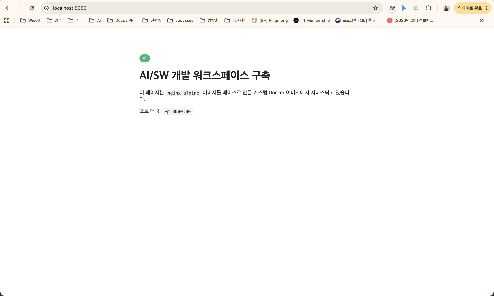
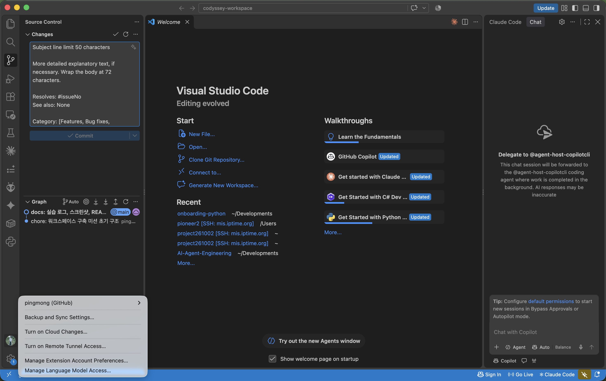

# AI/SW 개발 워크스페이스 구축

Codyssey 입학연수 Pre-course · Dev Setup 미션 수행 기록

터미널 · Docker · Git을 직접 세팅하고, 누가 실행해도 같은 결과가 나오는 개발 환경을 만드는 미션입니다.
처음 보는 분은 단계별 설명서 **[GUIDE.md](GUIDE.md)** 를 먼저 읽어 주세요. 이 문서는 제출용 요약입니다.

<br>

## 실행 환경

| 항목 | 값 |
|:--|:--|
| OS | macOS 26.7.1 (Apple Silicon) |
| 셸 | zsh + Bash 스크립트 |
| Docker | 29.8.1 (Docker Desktop) · Compose v5.5.1 |
| Git | 2.50.1 · gh CLI 2.103.3 |
| 에디터 | VSCode |

<br>

## 저장소 구조

```
app/              커스텀 이미지 소스 (Dockerfile, index.html)
compose-single/   보너스 · 단일 서비스 Compose
compose-multi/    보너스 · 웹 + Redis 멀티 컨테이너
scripts/          실습 스크립트 4개 — 순서대로 실행하면 logs/ 에 결과 기록
logs/             실행 로그 (증거) · trouble-* 는 실패 당시 로그
screenshots/      브라우저 접속, VSCode 연동 캡처
GUIDE.md          수강생용 단계별 설명서
```

<br>

## 수행 항목

| # | 항목 | 증거 |
|:-:|:--|:--|
| 1 | 터미널 조작 — pwd, ls -la, mkdir, touch, cat, cp, mv, rm | `logs/01` |
| 2 | 권한 변경 — 파일 755 ↔ 644, 디렉토리 700 ↔ 755 전/후 비교 | `logs/02` |
| 3 | Docker 설치 점검 — `docker --version`, `docker info` | `logs/03` |
| 4 | Docker 운영 — images, ps, ps -a, logs, stats, stop/start/rm | `logs/04` |
| 5 | 컨테이너 실습 — hello-world, ubuntu, 종료 vs 유지(exec) | `logs/05` |
| 6 | 커스텀 이미지 — `nginx:alpine` + 정적 페이지 Dockerfile | `logs/06` |
| 7 | 포트 매핑 — `-p 8080:80` → HTTP 200 | `logs/07` · `screenshots/port-mapping.png` |
| 8 | 바인드 마운트 — 호스트 수정 즉시 반영 | `logs/08` |
| 9 | 볼륨 영속성 — 컨테이너 삭제 후 데이터 유지 | `logs/09` |
| 10 | Git 설정 · GitHub · VSCode 연동 | `logs/10` · `screenshots/vscode-github.png` |
| 11 | 보안 — 토큰/이메일 마스킹, `.env` 제외 | 본 문서 전체 |
| B1 | Compose 단일 서비스 | `logs/11` |
| B2 | Compose 멀티 컨테이너 + 네트워크 통신 | `logs/12` |
| B3 | Compose 운영 명령 up / ps / logs / down | `logs/11`, `logs/12` |
| B4 | 환경 변수로 포트 변경 | `logs/13` |
| B5 | GitHub SSH 키 | `logs/14` |

모든 항목 완료.

<br>

## 핵심 결과

### 권한

```
perm.sh    -rw-r--r--  →  Permission denied
chmod 755  -rwxr-xr-x  →  run ok
chmod 644  -rw-r--r--  →  Permission denied
perm-dir/  drwxr-xr-x  →  chmod 700  →  drwx------
```

### 커스텀 이미지

```dockerfile
FROM nginx:alpine
COPY --chmod=644 index.html /usr/share/nginx/html/index.html
EXPOSE 80
HEALTHCHECK --interval=10s --timeout=3s CMD wget -qO- http://localhost/ > /dev/null || exit 1
```

| 커스텀 포인트 | 목적 |
|:--|:--|
| `COPY --chmod=644` | 기본 페이지를 내 페이지로 교체. 권한을 고정해 비root nginx 워커가 읽을 수 있게 |
| `EXPOSE 80` | 사용 포트 문서화 (실제 개방은 `-p`) |
| `HEALTHCHECK` | 서비스 생존 여부를 Docker가 감지 |

```
$ docker build -t codyssey-web:v1 ./app        → codyssey-web:v1  26.3MB
$ docker run -d --name web -p 8080:80 codyssey-web:v1
$ curl -s -o /dev/null -w '%{http_code}' localhost:8080   → 200
```



### 바인드 마운트 vs 볼륨

```
바인드   -v $(pwd)/app:/usr/share/nginx/html    호스트 파일 수정 → 재시작 없이 v1 → v2 반영
볼륨     -v codyssey-data:/data                 컨테이너 A 삭제 후 B 에서 persist.txt 그대로 읽힘
비교     볼륨 없이 쓴 파일                        다음 컨테이너에서 No such file
```

### 컨테이너 종료 vs 유지

```
ubu-once   bash -c '...'   → Exited (0)   메인 프로세스가 끝나면 종료
ubu-keep   sleep 600       → Up           살아 있는 동안 docker exec 로 진입 가능
```

### Git · GitHub

```
user.name = pingmong · user.email = ****  · init.defaultbranch = main
credential.helper = gh auth git-credential
origin = git@github.com:pingmong/codyssey-workspace.git (SSH)
```



<br>

## 보너스

| | 결과 | 배움 포인트 |
|:-:|:--|:--|
| B1 | `docker compose up -d --build` → 8080 접속 200 → `down` | `docker run` 명령을 yml로 문서화 |
| B2 | web → `cache:6379` open, `redis-cli ping` → PONG | 서비스 이름 = 호스트 이름 |
| B3 | up / ps / logs --tail / down | 운영 상태 확인 루틴 |
| B4 | `.env`의 `WEB_PORT=9090` 만으로 9090 접속 200 | 설정과 코드의 분리 |
| B5 | `ssh -T git@github.com` → authenticated, 원격 SSH 전환 | 토큰(HTTPS) vs 키 쌍(SSH) |

<br>

## 트러블슈팅

**1. `git push` → `'credential-winstore' is not a git command`**
`~/.gitconfig`에 Windows용 자격증명 헬퍼가 남아 있었음. `git config --show-origin --get-all credential.helper`로 확인 → `--unset-all` 후 `gh auth login`, `gh auth setup-git`으로 해결.

**2. 커스텀 이미지 접속 시 `403 Forbidden`**
호스트 `index.html`이 600인 채로 COPY되어 비root nginx 워커가 읽지 못함. `docker logs web`의 `Permission denied`로 확인 → `chmod 644` + `COPY --chmod=644`로 해결. 같은 파일을 바인드 마운트하면 정상(200)이었던 점이 단서.

**3. `Conflict. The container name "/web" is already in use`**
옛 이미지로 띄운 컨테이너가 살아서 이름·포트 점유. `docker ps`의 IMAGE 열이 새 이미지가 아님을 확인 → `docker rm -f web` 후 재실행.

**4. `git add` → `CRLF would be replaced by LF`**
403 응답 본문(HTTP는 CRLF)이 로그에 섞임 + `core.safecrlf` 보호. `grep -rl $'\r' logs`로 1개 파일 확인 → `sed -i 's/\r//g'`로 해결.

실패 당시 로그: `logs/trouble-*` · `screenshots/trouble-02-403-before.png` · 상세 서술은 [GUIDE.md](GUIDE.md#트러블슈팅-막혔던-곳과-푼-방법)

<br>

## 배운 점

**이미지 ≠ 컨테이너.** 이미지는 설계도, 컨테이너는 실물. 새로 빌드해도 떠 있는 컨테이너는 옛 이미지를 쓴다(트러블슈팅 3).

**격리.** 컨테이너 안의 OS·파일시스템·사용자는 호스트와 다르다. 그래서 호스트 파일 권한이 컨테이너 안에서 문제가 된다(트러블슈팅 2).

**연결은 명시적으로.** 네트워크는 `-p`, 파일은 `-v`. 바인드 마운트는 개발 중 즉시 반영, 볼륨은 영속 데이터.

**Dockerfile vs Compose.** Dockerfile은 이미지를 *어떻게 만들지*, Compose는 *어떤 설정으로 띄울지*. 실행 명령을 파일로 적어 두면 누구나 한 줄로 재현한다.

**Git vs GitHub.** Git은 로컬 버전 관리, GitHub는 공유·협업 플랫폼. 둘을 잇는 인증은 별도 설정이다(트러블슈팅 1).

<br>

## 보안

토큰·비밀번호·개인키 없음 확인. `logs/10`의 이메일·서명키 마스킹. `.env`는 `.gitignore`로 제외하고 `.env.example`만 커밋.
